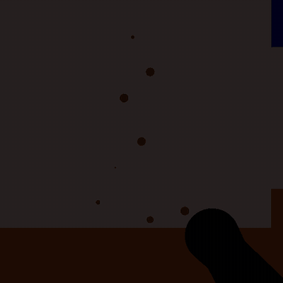

# Horror-Labyrinth

Dieses Projekt ist im 3. Bachelorsemester im Modul "Graphische Datenverarbeitung" entstanden. Ziel war es, mit OpenGL eine eigene kleine 3D-Szene zu bauen, durch die man sich frei bewegen kann. Es war gleichzeitig mein allererstes Coding-Projekt überhaupt. Man könnte daran also auf jeden Fall noch einiges optimieren, aber für ein erstes Projekt bin ich ziemlich stolz darauf. 



## Das Spiel

Man startet in einem dunklen Labyrinth und muss den Schlüssel finden, um durch die Tür am anderen Ende zu entkommen. Unterwegs begegnet man einem Totenkopf, Frankenstein, einer Spinne, einem Geist und einem riesigen Auge. Frankenstein und die Spinne versperren den Weg und müssen übersprungen werden. Der Geist verfolgt einen in seinem Gang, und wer vom Geist oder vom Auge erwischt wird, landet wieder am Start. Die Taschenlampe leuchtet immer dorthin, wo man gerade hinschaut.

Steuerung:

- **Enter:** Spiel starten
- **Pfeiltasten:** laufen und drehen
- **Leertaste:** hüpfen
- **Mausklick:** Schlüssel aufheben bzw. Tür aufschließen
- **E / A:** Taschenlampe an / aus
- **Esc:** beenden

Gezeichnet wird mit der klassischen Fixed-Function-Pipeline von OpenGL über LWJGL 3. Alle Objekte sind aus parametrisierten Flächen (Kugeln, Ellipsoide, Zylinder, Rechtecke) zusammengesetzt und werden beim Start einmal in Display-Listen kompiliert. Beleuchtet wird die Szene von drei Spotlichtern: der Taschenlampe, dem Mond und einem Licht über dem Schlüssel. Für die Kollision liegt ein Raster aus 5 x 5 cm großen Zellen über dem Labyrinth, in dem jede Zelle einem Bereich zugeordnet ist (Mauer, Gang, Spinne, ...). Über diesen Bereich wird auch entschieden, welcher Teil des Labyrinths gerade gezeichnet wird.

## Aufbau

```
src/
  Main.java                 Einstiegspunkt, erstellt das Fenster und führt die Spielschleife aus
  szene/                    Szene (Kamera, Steuerung, Spiellogik) und Abschlussfenster
  labyrinth/                Mauern und Boden der einzelnen Gänge sowie die Kollisionskarte
  objekte/                  Objekte im Labyrinth (Auge, Geist, Spinne, Tür, ...)
  grafik/                   Grundformen, Materialien und Spotlicht
pom.xml                     Maven-Konfiguration mit LWJGL und JOML
```

- **Szene:** `Szene` hält den Zustand von Spieler, Geist, Auge und Schlüssel, verarbeitet die Eingaben und zeichnet pro Frame nur den Gang, in dem man sich gerade befindet.
- **Labyrinth:** `Karte` ordnet jeder Zelle einen Bereich zu. `Labyrinth` beschreibt pro Gang, welche Mauern von dort aus sichtbar sind, und setzt sie aus wiederverwendeten Kacheln zusammen.
- **Objekte:** Jedes Objekt erbt von `Objekt` und legt in `zeichnen()` seine Geometrie fest, die beim Start in eine Display-Liste kompiliert wird.
- **Grafik:** `Formen` enthält die Grundformen, `Material` die Materialeigenschaften für die Beleuchtung und `Licht` kapselt eine OpenGL-Lichtquelle.
